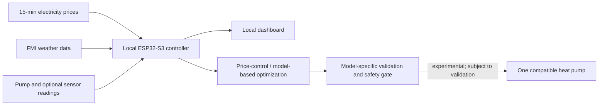

# Enevina Lite

**Local-first heat pump control and electricity-price optimization — running on ESP32-S3.**

Enevina Lite is a source-available project by **Enevina Ltd** (registered in Finland as **Enevina Oy**). The design is simple: **one heat pump per controller**, a local browser dashboard, and price-aware heating without requiring Home Assistant, a cloud account, or an always-on server. The optimization is deterministic and physics-based — **there is no AI/ML in Lite**.

[English](#english) · [Suomi](#suomi) · [Developer preview v0.1.0-alpha.1](https://github.com/Enevina-Ltd/ENEVINA-Lite/releases/tag/v0.1.0-alpha.1) · [Compatibility](docs/COMPATIBILITY.md) · [Getting started](docs/GETTING_STARTED.md)

> **Developer preview — not ready for general installation or sale.** The repository contains working prototypes, tested algorithms, experimental device adapters and firmware. It does **not** certify model compatibility, a safe automatic-control installation, or real-world energy savings. There is no approved prebuilt firmware installer in the first release.

## English

### Why Enevina Lite?

- **Local by design.** The device runs its own dashboard and local control logic. Electricity-price and weather updates use online data sources, but a continuous cloud connection is not the design requirement.
- **Electricity prices + weather.** Finnish 15-minute electricity-price periods and FMI weather forecasts are integrated as inputs for monitoring and optimization development.
- **Predictive control research on an ESP32.** A lightweight thermal model and deterministic MPC can be simulated and benchmarked on the host; the real device's current price-control path is **not yet a field-validated MPC controller**.
- **Manufacturer adapters, not a one-brand product.** The first integration work targets Mitsubishi Electric / CN105. Other brands require their own verified adapters and model-specific tests.

### What is available today?

| Area | Current evidence | What is *not* yet claimed |
| --- | --- | --- |
| ESP32-S3 local dashboard | Firmware implementation, Finnish/English UI and host-side tests | Tested operation on every browser and hardware configuration |
| Wi-Fi-first setup | Implemented; host-tested onboarding state machine | Generally validated end-user provisioning |
| 15-min electricity prices | Acquisition, caching and pricing logic in source | Accuracy for every electricity contract |
| FMI weather forecast | Local forecast integration and 48-hour display development | Calibrated use in production MPC control |
| RuuviTag and Shelly | Adapter/parser and integration work, selected device tests | Universal sensor compatibility or pump-only power measurement |
| Midea V3 LAN | Native C++ crypto/protocol and experimental ESP32 read-only transport, [details](docs/MIDEA_V3_LOCAL_WIFI.md) | Not connected to device settings or control; no Lite field test |
| Mitsubishi CN105 | First model-specific experimental integration | Certified or universally safe control of Mitsubishi models |
| Thermal model + MPC | Host simulation, independent MILP comparisons and benchmark reports | Verified real-world cost savings; MPC as the active calibrated control loop |
| Signed OTA / recovery | Implementation and targeted regression/device tests | A universally approved end-user firmware update |

The details and evidence levels are documented in [Compatibility & development status](docs/COMPATIBILITY.md), [optimization audit](docs/OPTIMIZATION_AUDIT_20261118.md) and [release readiness](docs/release/RELEASE_READINESS.md). Historical test reports document their test date, not a blanket claim about current product readiness.

### How it works



The diagram shows the intended architecture. Not every displayed connection is an approved physical control path.

### Try the development tools

For a safe, **PC-only** introduction (no physical pump commands, firmware flashing or device credentials):

```sh
git clone https://github.com/Enevina-Ltd/ENEVINA-Lite.git
cd ENEVINA-Lite
cmake -S . -B build
cmake --build build
ctest --test-dir build --output-on-failure
```

Requirements: CMake 3.20+, a C++17 compiler and Git. See [Getting started](docs/GETTING_STARTED.md) for repository structure, further tests and hardware limitations. The ESP32 firmware has separate build configurations and must **not** be flashed onto an unknown board as part of this introduction.

### Follow or contribute

Interested in local heat-pump protocols, deterministic optimization or testing an adapter? Browse the [latest developer preview](https://github.com/Enevina-Ltd/ENEVINA-Lite/releases/tag/v0.1.0-alpha.1), open a [Discussion](https://github.com/Enevina-Ltd/ENEVINA-Lite/discussions) to ask a question, or use [Issues](https://github.com/Enevina-Ltd/ENEVINA-Lite/issues) for reproducible bugs and well-scoped requests. We especially welcome **model-specific compatibility evidence**; please don't post private IPs, credentials, MAC addresses or unredacted device logs.

No verified demonstration video or field-savings figure has been published yet. Contributions must follow [CONTRIBUTING.md](CONTRIBUTING.md).

## Suomi

**Enevina Lite on ESP32-S3:lle kehitettävä paikallinen lämpöpumppuohjain.** Yksi laite ohjaa yhtä lämpöpumppua. Tavoitteena ovat lämmityskustannusten optimointi 15 minuutin sähkönhinnoilla, sääennusteella ja rakennuksen fysiikkamallilla, ilman Home Assistant -pakkoa, tilausta tai jatkuvaa pilviyhteyttä. **Lite ei sisällä tekoälyä.**

Projekti on **kehittäjien esijulkaisu**, ei valmis asiakastuote. Mitsubishi Electricin CN105 on ensimmäinen kokeellinen integraatio; muiden lämpöpumppujen tuki varmistetaan mallikohtaisesti. Rakennusmallin ja MPC:n tulokset ovat toistaiseksi pääosin simuloituja, eikä todellisia säästöprosentteja luvata.

- [Aloita turvallisesti PC:llä](docs/GETTING_STARTED.md)
- [Yhteensopivuus ja ominaisuuksien tila](docs/COMPATIBILITY.md)
- [Ensimmäinen alpha-julkaisu](https://github.com/Enevina-Ltd/ENEVINA-Lite/releases/tag/v0.1.0-alpha.1)
- [Kysy tai esittele oma lämpöpumppumallisi](https://github.com/Enevina-Ltd/ENEVINA-Lite/discussions)
- [Ilmoita toistettava ongelma](https://github.com/Enevina-Ltd/ENEVINA-Lite/issues)

## Project structure

| Path | Purpose |
| --- | --- |
| `cottage/` | Air-to-air prototype: price control, thermal model, MPC, telemetry and safety |
| `physics/`, `optimizer/` | Independent physical model and optimization research |
| `forecast/` | Weather, electricity prices and data validation |
| `pump/` | Device adapter interfaces and data-quality contracts |
| `firmware/cottage/` | ESP32-S3 Wi-Fi firmware, dashboard, sensors and OTA development |
| `firmware/` | Separate ESP-IDF and benchmark programs |
| `tests/`, `tools/` | Native regressions, simulation and independent comparisons |

## License, safety and commercial use

**Enevina Lite is source-available, not OSI open source.** The [Enevina Lite Noncommercial Community License 1.0](LICENSE) permits noncommercial study, hobby use, modification and noncommercial sharing under its terms. **Selling Enevina Lite software/firmware or controllers incorporating it requires a separate written commercial license from Enevina Oy.** Third-party components retain their own rights and notices; see [THIRD_PARTY_NOTICES.md](THIRD_PARTY_NOTICES.md). The custom license has **not received independent legal review**.

This developer preview is not approved for unattended physical heat-pump control. Do not use price optimization to switch the pump's mains power; respect compressor protection, defrosting and manufacturer limits. Firmware compatibility and OTA/rollback procedures must be verified for the exact board and pump model before installation.

**Enevina Ltd** · [enevina.com](https://enevina.com) · [Contributing](CONTRIBUTING.md) · [Release readiness](docs/release/RELEASE_READINESS.md)